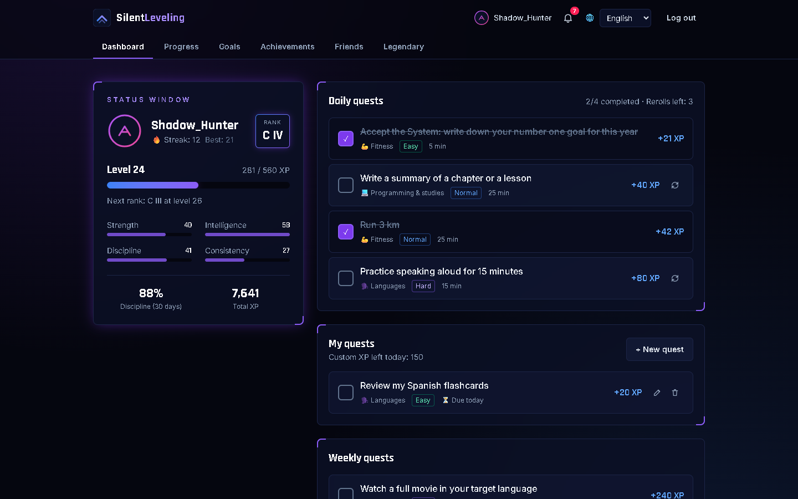
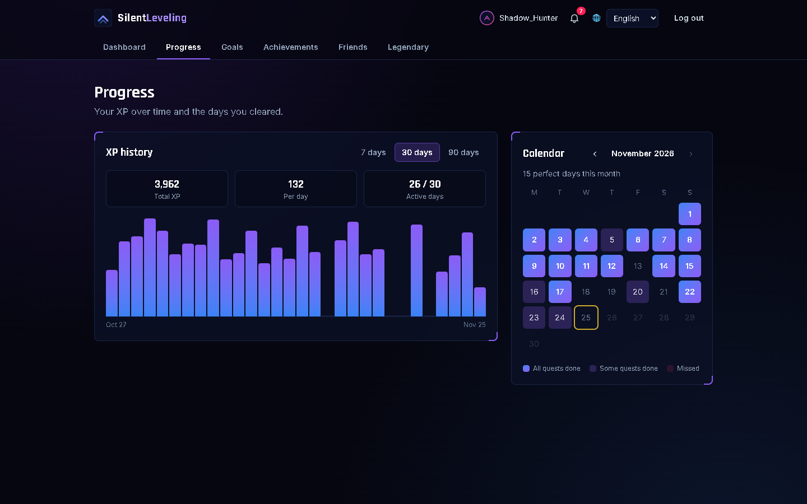
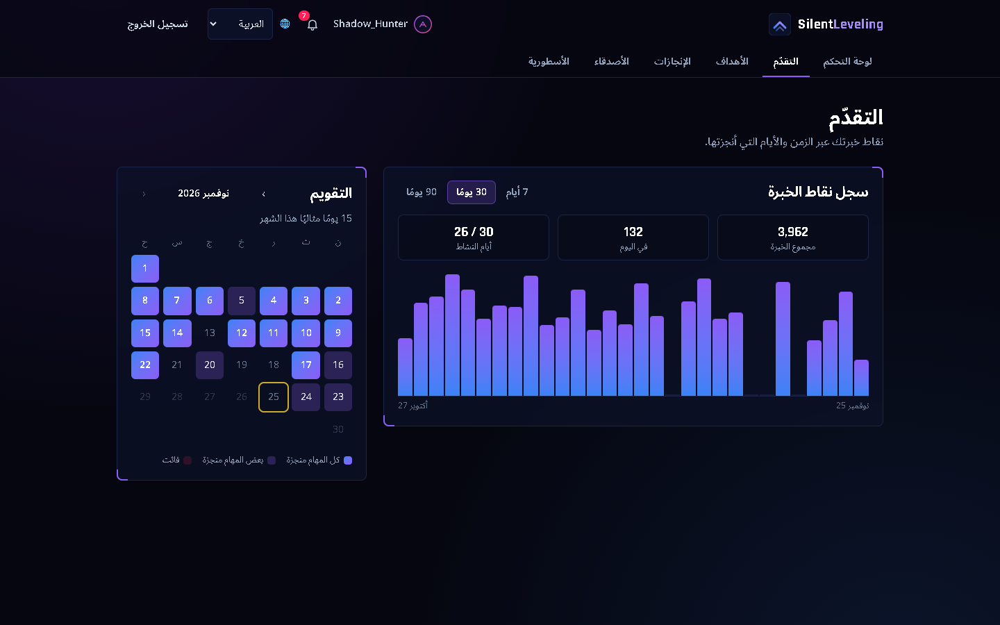
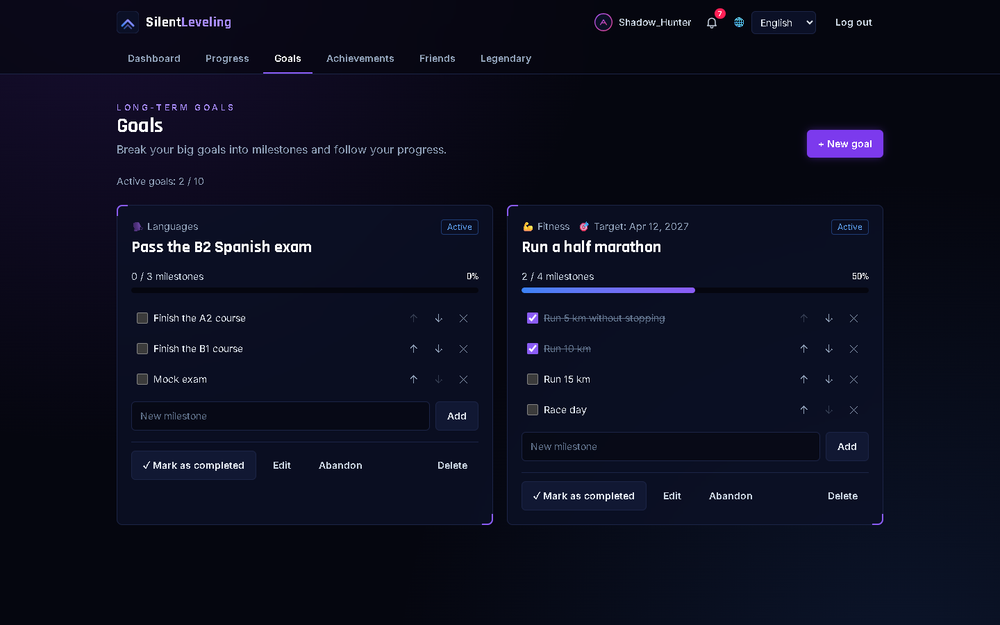
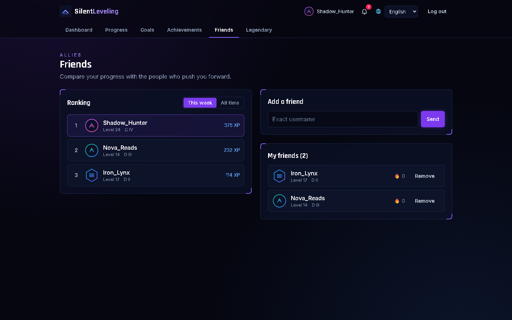
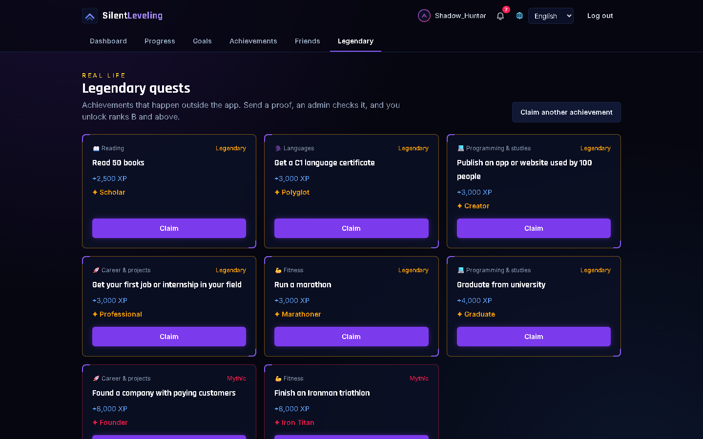
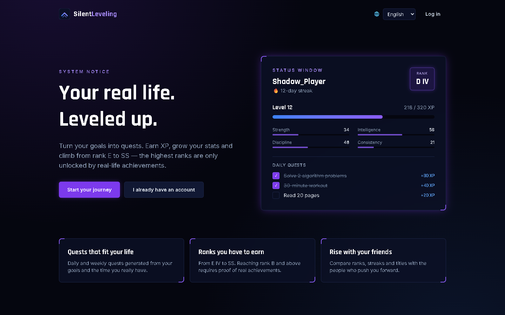
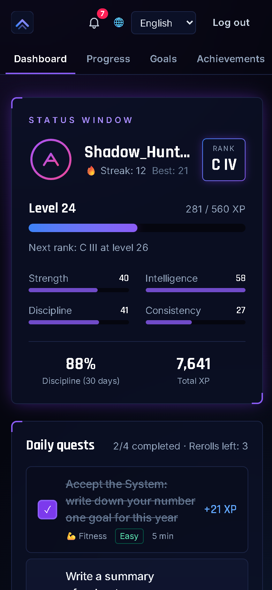
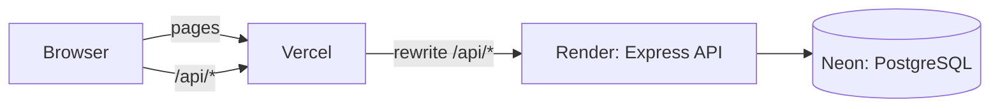

# SilentLeveling

> Your real life. Leveled up.

**Live:** https://silentleveling.vercel.app · **API docs:** https://silentleveling.vercel.app/api/docs/

SilentLeveling turns real-life goals and habits into an RPG. You get daily and weekly quests that fit your goals and your available time, earn XP, grow your stats and climb from rank **E IV** to **SS**. The top ranks can't be grinded: they unlock only when an admin verifies a real achievement, like a finished marathon or a first job.



_The free backend sleeps when nobody uses it: the first request can take about a minute._

## Features

- **Quests made for you.** Daily and weekly quests are generated from your focus areas (fitness, studies, languages, reading, career, health), your level in each and the minutes you have per day. One reroll per day; custom quests with capped XP.
- **Progression.** XP depends on difficulty only, so a fast player isn't penalized. Levels, 25 ranks, four stats, streaks, and a penalty quest that can save a broken streak.
- **Long-term goals** split into milestones, with quests linked to them.
- **Achievements and titles** unlocked automatically, with in-app notifications.
- **Friends**: profiles and a weekly or all-time ranking among friends only. No global leaderboard.
- **Legendary quests**: claim a real-life achievement with a proof link; an admin reviews it, grants XP and a title, and that unlocks ranks B and above. Admins can also edit the catalog.
- **Progress page**: XP chart over 7, 30 or 90 days and a calendar of cleared days.
- **Installable and offline-ready**: install it on a phone or PC. Offline you can still see your data, complete quests, add your own and tick milestones; changes sync when you're back online.
- **English, French and Arabic**, with a full right-to-left layout in Arabic.
- **Responsive and accessible**: Lighthouse accessibility 100, no axe violations on any page.

<table>
  <tr>
    <td></td>
    <td></td>
  </tr>
  <tr>
    <td></td>
    <td></td>
  </tr>
  <tr>
    <td></td>
    <td></td>
  </tr>
</table>

<p align="center"></p>

## Tech stack

| Layer    | Technologies                                                                  |
| -------- | ----------------------------------------------------------------------------- |
| Frontend | React 19, TypeScript, Vite, Tailwind CSS, TanStack Query, i18next             |
| Backend  | Node.js 22, Express 5, TypeScript, Zod, OpenAPI / Swagger UI                  |
| Database | PostgreSQL 17, Prisma ORM                                                     |
| Testing  | Vitest, Supertest, Testing Library (300+ tests, ≥ 90% coverage on game logic) |
| Tooling  | ESLint, Prettier, Docker Compose, GitHub Actions                              |
| Hosting  | Vercel (frontend), Render (API), Neon (database)                              |

The reasons behind each choice are in the [SRS §6.1](docs/SRS.md#61-technology-choices).

## How it works



- **One domain.** Vercel forwards `/api/*` to the API, so the login cookie (HttpOnly, SameSite) works without any cross-site setup.
- **Game rules are pure functions** in `server/src/game/`, with every number in one config file. They are the most tested part.
- **XP is a ledger.** Each gain is a row; unique keys make it impossible to pay a quest or a claim twice, even on a double click.
- **No cron job.** Free hosting sleeps, so each player's day is closed on their first request after their local midnight, inside a locked transaction.
- **Errors are codes** (`QUEST_NOT_FOUND`), translated by the frontend into the player's language.

More in [docs/DATABASE.md](docs/DATABASE.md) and the [SRS](docs/SRS.md).

## Getting started

Needs [Node.js](https://nodejs.org/) 22+ and [Docker Desktop](https://www.docker.com/products/docker-desktop/).

```bash
npm install                              # frontend + backend (npm workspaces)
cp server/.env.example server/.env       # local settings
npm run db:up                            # PostgreSQL in Docker
npm run db:migrate -w server             # create the tables
npm run db:seed -w server                # reference data
npm run dev                              # API on :4000, app on :5173
```

Open http://localhost:5173. API docs: http://localhost:4000/api/docs.

To make a player an admin: `npm run make-admin -w server -- <username>`.

## Scripts

Run from the project root:

| Command                     | Description                              |
| --------------------------- | ---------------------------------------- |
| `npm run dev`               | Start backend and frontend in watch mode |
| `npm test`                  | Run all tests                            |
| `npm run lint`              | Lint both apps                           |
| `npm run typecheck`         | Type-check both apps                     |
| `npm run format`            | Format every file with Prettier          |
| `npm run build`             | Production build of both apps            |
| `npm run db:up` / `db:down` | Start / stop the local database          |

## Deployment

- **Database:** a Neon project; its direct (non-pooled) connection string is the API's `DATABASE_URL`.
- **API:** Render, from [`render.yaml`](render.yaml). Each start applies migrations and the seed.
- **Frontend:** Vercel with root directory `client`; [`client/vercel.json`](client/vercel.json) holds the `/api` rewrite.
- Every push to `main` redeploys both. CI (lint, types, tests, build) must pass before a PR can be merged.

## Project structure

```
SilentLeveling/
├── client/        # React app (features/, components/, i18n/)
├── server/        # Express API (modules/, game/, prisma/)
├── docs/          # SRS, database docs, screenshots
├── render.yaml    # API hosting
└── .github/       # CI workflow
```

## Documentation

- [Software Requirements Specification](docs/SRS.md): requirements, game rules, architecture, API design
- [Database](docs/DATABASE.md): diagram, tables, integrity rules, migrations
- [API reference](https://silentleveling.vercel.app/api/docs/) (Swagger)

## License

All rights reserved. This is a personal portfolio project.
