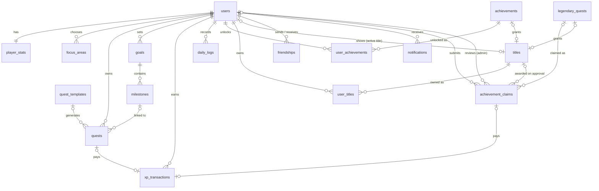

# Database

PostgreSQL 17, accessed through Prisma 7 (`server/prisma/schema.prisma`). Locally it runs in Docker; in production on [Neon](https://neon.tech). The design decisions behind it are in the [SRS §7](SRS.md#7-database-design). This page is the practical reference.

## Diagram



## Tables

| Table                 | Holds                                                                                                        |
| --------------------- | ------------------------------------------------------------------------------------------------------------ |
| `users`               | Account, settings (language, time zone, daily minutes), cached progression (total XP, level, rank, streaks). |
| `player_stats`        | Strength, intelligence, discipline, consistency (1:1 with users).                                            |
| `focus_areas`         | The categories a player chose at onboarding, with their skill level.                                         |
| `quest_templates`     | **Reference data.** The pool daily and weekly quests are generated from.                                     |
| `quests`              | Every quest a player received or created: daily, weekly, penalty, custom.                                    |
| `goals`, `milestones` | Long-term goals and their ordered steps.                                                                     |
| `xp_transactions`     | **The XP ledger.** One row per gain; a player's total XP is the sum of their rows.                           |
| `daily_logs`          | One row per closed day: quests given and completed. Feeds the streak, discipline rate and calendar.          |
| `achievements`        | **Reference data.** Unlock rules (code, threshold, optional title).                                          |
| `user_achievements`   | Achievements a player unlocked, with the date.                                                               |
| `titles`              | **Reference data**, plus titles an admin creates when approving a claim (key `custom_…`).                    |
| `user_titles`         | Titles a player owns.                                                                                        |
| `friendships`         | Friend requests and friendships (pending or accepted).                                                       |
| `notifications`       | In-app notifications (level up, achievement, friend request, claim reviewed…).                               |
| `legendary_quests`    | **Catalog** of real-life achievements. Seeded, then editable by admins.                                      |
| `achievement_claims`  | A player's request to have a real-life achievement verified, and the admin's decision.                       |

## Integrity rules

The database itself refuses invalid data, so a bug in the code cannot corrupt it. Prisma cannot express CHECK constraints, so they are added by hand at the end of the migrations.

**No XP paid twice.** `xp_transactions.quest_id` and `xp_transactions.claim_id` are unique. A double click or a retried request on "complete quest" or "approve claim" fails at the database instead of paying twice.

**One friendship per pair.** A unique index on `(LEAST(requester_id, addressee_id), GREATEST(requester_id, addressee_id))` blocks a second request in either direction; a CHECK forbids befriending yourself.

**Status and dates agree.** For quests and goals, `status = 'COMPLETED'` exactly when `completed_at` is set. For claims, `status = 'PENDING'` exactly when `reviewed_at` is null, and an approved claim always has a tier and a positive XP amount.

**Ranges.** XP totals, levels, streaks and stats are never negative; an XP transaction is never 0; quest durations stay between 5 and 240 minutes; `daily_minutes` is one of 15, 30, 60, 120, 240; a day never has more completed quests than given ones.

**Deleting.** Deleting a user cascades to everything they own. Links to optional things are set to null instead: a deleted milestone leaves its quests, a deleted legendary quest leaves its claims.

## Indexes

Besides primary keys and unique columns, indexes follow the queries the app actually makes:

| Index                                     | Used by                                        |
| ----------------------------------------- | ---------------------------------------------- |
| `quests (user_id, quest_date)`            | Today's quests                                 |
| `quests (user_id, status)`                | Active custom quests, rollover                 |
| `xp_transactions (user_id, created_at)`   | XP history chart, weekly ranking among friends |
| `notifications (user_id, created_at)`     | Notification panel                             |
| `friendships (addressee_id, status)`      | Incoming requests                              |
| `achievement_claims (status, created_at)` | Admin review queue                             |
| `quest_templates (type, category, level)` | Quest generation                               |

## Migrations and seed

```bash
npm run db:migrate -w server   # development: create and apply a migration
npm run db:deploy -w server    # production: apply pending migrations only
npm run db:seed -w server      # reference data (idempotent)
npm run db:studio -w server    # browse and edit the data
```

- Migrations live in `server/prisma/migrations`, one folder per change, and are applied in order. They are never edited once merged.
- The seed upserts titles, achievements and quest templates from `server/src/game/catalog.ts`. Legendary quests are only **created** when missing, never overwritten, so changes an admin makes in the app survive the next deploy.
- In production, Render runs `db:deploy` then `db:seed` before every start (see `render.yaml`).
- Integration tests use a separate database (`silentleveling_test`), emptied between tests except for the reference tables.
