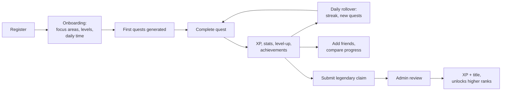
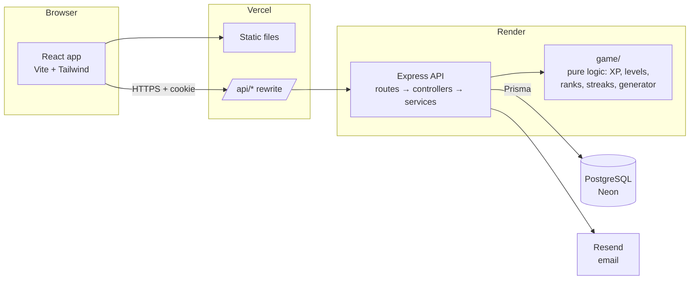
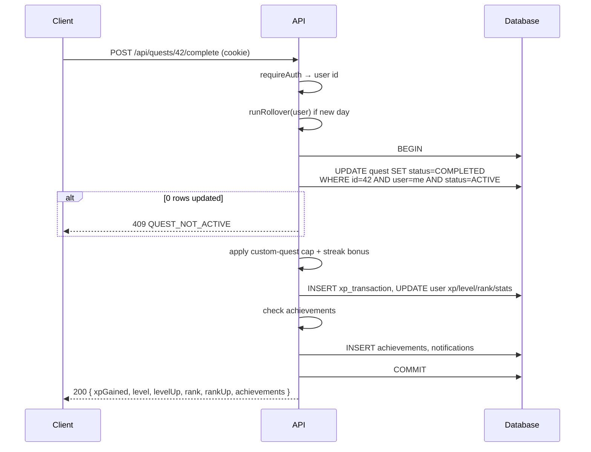
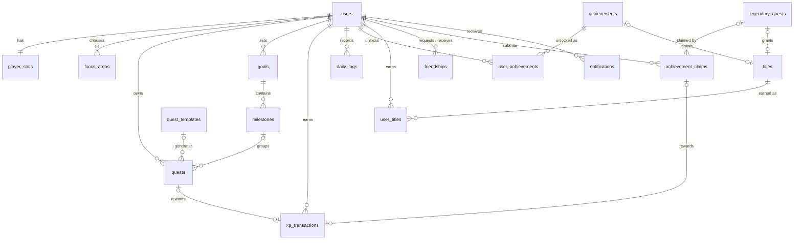

# SilentLeveling — Software Requirements Specification

|             |                                                           |
| ----------- | --------------------------------------------------------- |
| **Version** | 0.2 (draft for approval): XP now based on difficulty only |
| **Date**    | 2026-11-24                                                |
| **Author**  | Ahmed                                                     |
| **Status**  | Awaiting approval                                         |

---

## Table of contents

1. [Introduction](#1-introduction)
2. [Overall description](#2-overall-description)
3. [Game rules](#3-game-rules)
4. [Functional requirements](#4-functional-requirements)
5. [Non-functional requirements](#5-non-functional-requirements)
6. [System architecture](#6-system-architecture)
7. [Database design](#7-database-design)
8. [REST API](#8-rest-api)
9. [Visual identity](#9-visual-identity)
10. [Development roadmap](#10-development-roadmap)
11. [Future work](#11-future-work)
12. [Decisions to approve](#12-decisions-to-approve)

---

## 1. Introduction

### 1.1 Purpose

This document describes what SilentLeveling must do and how it will be built. It is the reference for development: if a feature is not in here, it is not part of the plan until the document is updated.

### 1.2 Product summary

SilentLeveling is a web application that turns real-life goals and habits into an RPG progression system. Players complete daily, weekly and long-term quests, earn XP, level up, grow four personal stats, and climb through ranks from **E IV** to **SS**. The highest ranks can only be reached by proving real-life achievements, which an admin verifies. Players add friends to compare their progress.

### 1.3 Scope

**In scope (v1):** accounts, onboarding, rule-based quest generation, custom quests, goals and milestones, XP/levels/ranks/stats, discipline streaks, penalty quests, achievements and titles, friends and profiles, legendary quests with admin-verified claims, in-app notifications, English/French/Arabic interface, responsive design, deployment.

**Out of scope (v1):** AI-generated quests, a global leaderboard, image uploads, password reset by email, mobile app stores, guilds/parties. See [Future work](#11-future-work).

### 1.4 Definitions

| Term                | Meaning                                                                                                |
| ------------------- | ------------------------------------------------------------------------------------------------------ |
| **Player**          | A registered user.                                                                                     |
| **Admin**           | A player with the `ADMIN` role who reviews achievement claims and manages legendary quests.            |
| **Quest**           | A task with a category, difficulty, estimated duration and deadline.                                   |
| **System quest**    | A quest generated by the quest engine from a template.                                                 |
| **Custom quest**    | A quest written by the player.                                                                         |
| **Penalty quest**   | A quest given after a missed day; completing it restores the streak.                                   |
| **Legendary quest** | A long-term, real-life achievement (e.g. "Run a marathon"). No deadline; verified by an admin.         |
| **Claim**           | A player's request to have a legendary quest or extraordinary achievement verified.                    |
| **Focus area**      | A category the player chose during onboarding, with their current level in it.                         |
| **XP ledger**       | The table recording every XP gain. The player's total XP is the sum of this ledger.                    |
| **Rollover**        | The processing of a player's finished day: closing quests, updating the streak, generating new quests. |
| **Rank**            | E IV → … → S I → SS. Determined by level **and** verified legendary achievements.                      |
| **Title**           | A label displayed next to the username, earned through achievements or legendary quests.               |

---

## 2. Overall description

### 2.1 User classes

| Class       | Description                                   | Main goals                                                   |
| ----------- | --------------------------------------------- | ------------------------------------------------------------ |
| **Visitor** | Not logged in.                                | Learn what the app is, register, log in.                     |
| **Player**  | Registered user.                              | Manage quests and goals, progress, compare with friends.     |
| **Admin**   | Player with extra rights (the project owner). | Review claims, award XP and titles, manage legendary quests. |

### 2.2 Main user flow



### 2.3 Constraints

- Free hosting tiers (Vercel, Render, Neon). The backend can "sleep" when idle, so **no feature may depend on a background job running at an exact time** (see rollover in §3.6).
- Real-life task completion cannot be proven by software. The design limits abuse instead of claiming to prevent it (§3.9).
- Three languages, including Arabic (right-to-left), from the first milestone.
- One developer; architecture must stay understandable and testable.

### 2.4 Assumptions

- Players have a modern browser (last 2 versions of Chrome, Firefox, Safari, Edge).
- Players' time zone is detected from the browser at registration and can be changed in settings.
- The expected scale is tens to hundreds of players.

---

## 3. Game rules

All numbers below live in **one configuration file** on the backend (`server/src/game/config.ts`), so they can be tuned without touching the logic. All calculations happen on the backend.

### 3.1 Categories and stats

| Category              | Strength | Intelligence | Discipline |
| --------------------- | -------- | ------------ | ---------- |
| Fitness               | 100%     |              |            |
| Programming / Studies |          | 100%         |            |
| Languages             |          | 100%         |            |
| Reading               |          | 50%          | 50%        |
| Career / Projects     |          | 50%          | 50%        |
| Health & habits       |          |              | 100%       |

- Completing a quest gives **stat points = XP ÷ 10**, split by the percentages above.
- **Consistency** does not come from categories: it gains **+1 for every day** on which all daily quests were completed.

### 3.2 XP rewards

XP depends **only on difficulty**: the harder the quest, the more XP it gives. Time does not affect XP.

```
XP = base XP of the difficulty × type multiplier × streak bonus
```

| Difficulty | Base XP | Allowed for custom quests |
| ---------- | ------- | ------------------------- |
| Easy       | 20      | ✅                        |
| Normal     | 40      | ✅                        |
| Hard       | 80      | ✅                        |
| Extreme    | 150     | ❌ (system quests only)   |

| Quest type    | Type multiplier | Why                                                       |
| ------------- | --------------- | --------------------------------------------------------- |
| Daily, custom | ×1              |                                                           |
| Weekly        | ×3              | A weekly quest is a bigger task spread over several days. |
| Penalty       | fixed 25 XP     | Restoring the streak is the real reward.                  |

- Each step up in difficulty roughly **doubles** the XP, so one Hard quest is worth four Easy ones. Choosing easy quests is always the slow path.
- Example: a daily Hard quest = **80 XP**; a weekly Normal quest = 40 × 3 = **120 XP**.
- **The player's daily time does not change XP per quest. It changes how many quests they get** (§3.6), so more time means more quests and more total XP.
- The XP reward is calculated **when the quest is created** and stored with it, so the player sees exactly what they will earn. The streak bonus is applied **at completion**.
- Legendary quests and claims have a fixed XP reward decided by the admin.

### 3.3 Levels

XP needed to go from level _n_ to level _n + 1_:

```
xpToNextLevel(n) = 100 + 20 × (n − 1)
```

| Level | XP to next level | Total XP to reach this level |
| ----- | ---------------- | ---------------------------- |
| 1     | 100              | 0                            |
| 2     | 120              | 100                          |
| 10    | 280              | 1 620                        |
| 30    | 680              | 11 020                       |
| 50    | 1 080            | 28 420                       |
| 100   | 2 080            | 106 920                      |

Closed form: total XP to reach level _L_ = `100 × (L − 1) + 10 × (L − 1) × (L − 2)`.

A linear increase is easy to explain and keeps levels reachable: a player earning ~180 XP/day (e.g. 1 Easy + 2 Normal + 1 Hard daily quest) reaches level 30 in about two months and level 100 in about a year and a half.

### 3.4 Ranks

A rank requires **a minimum level** and, from B upward, **verified legendary achievements**. A player's rank is the highest rank for which **both** conditions are met.

| Rank   | Divisions (min. level)                 | Real-life requirement               |
| ------ | -------------------------------------- | ----------------------------------- |
| **E**  | IV (1) · III (3) · II (5) · I (7)      | —                                   |
| **D**  | IV (10) · III (13) · II (16) · I (19)  | —                                   |
| **C**  | IV (22) · III (26) · II (30) · I (34)  | —                                   |
| **B**  | IV (38) · III (43) · II (48) · I (53)  | 1 verified Legendary                |
| **A**  | IV (58) · III (64) · II (70) · I (76)  | 3 verified Legendary                |
| **S**  | IV (82) · III (89) · II (96) · I (103) | 1 verified **Mythic** + 3 Legendary |
| **SS** | — (110)                                | 2 verified Mythic + 5 Legendary     |

- A verified **Mythic** achievement also counts toward the Legendary requirement (S = at least 4 verified achievements, of which 1 Mythic; SS = at least 7, of which 2 Mythic).
- A player at level 45 with no verified achievement stays **C I**. The UI shows "Rank locked — prove yourself in real life" with the missing requirement. XP keeps counting, so the rank jumps as soon as a claim is approved.
- **SS players** are compared by their titles (count weighted by rarity) instead of XP.
- The rank is stored on the user (a cached value) and recalculated whenever XP or verified achievements change.

### 3.5 Quest types

| Type      | Created by                 | Deadline                                   | XP                       |
| --------- | -------------------------- | ------------------------------------------ | ------------------------ |
| Daily     | Quest engine               | End of the player's day (local midnight)   | Formula                  |
| Weekly    | Quest engine               | End of Sunday (local time)                 | Formula                  |
| Custom    | Player                     | Chosen by the player (max 30 days)         | Formula, capped (§3.9)   |
| Penalty   | System, after a missed day | End of the day it appears (local midnight) | 25 XP fixed              |
| Legendary | Admin (catalog)            | None                                       | Fixed, on admin approval |

### 3.6 Quest engine (rule-based)

**Templates.** The database stores a library of quest templates. Each template has: category, level (beginner / intermediate / advanced), type (daily / weekly / penalty), estimated minutes, difficulty, and its title/description in EN/FR/AR. The estimated minutes are used **only** to fill the player's daily time; they never affect XP.

**Daily generation.** For each new day:

1. Time budget = the player's daily minutes (15, 30, 60, 120 or 240).
2. Candidates for a focus area: active templates matching its category and the player's level in it, excluding templates used in the last 3 days (unless no other template exists).
3. **Phase 1:** one random quest per focus area, so no goal is forgotten.
4. **Phase 2:** keep rotating through the focus areas, adding quests until the time budget is filled (−10 to +10 minutes), never going over +10. Minimum 1 quest, maximum 6.
5. 20 random plans are built and the best one is kept: first the one covering the most focus areas, then the one closest to the time budget. (Choosing one quest at a time can leave a gap no template fits; trying several plans avoids it.)

The first day also includes a 5-minute **starter quest** ("Accept the System…") in the player's main goal, so the first level-up comes within minutes (FR-13).

**Weekly generation.** Every Monday: 1 weekly quest per focus area (max 3).

**Level progression per focus area.** After **20 completed quests** in a category at beginner level, the player moves to intermediate; after **40** at intermediate, to advanced. The player can also change their level manually in settings.

**Rerolls.** A player can replace an uncompleted daily system quest with another one from the same category, **3 times per day**.

**Rollover (lazy evaluation).** Instead of a scheduled job, the rollover runs **on the player's first API request after their local midnight**:

1. For each past day that has not been processed (at most the last 60): mark unfinished daily quests `FAILED`, record a daily log, update the streak. A day on which the player never opened the app has no quests and counts as **missed**.
2. If the streak can still be saved (exactly one day missed after a streak), create a penalty quest.
3. Mark expired weekly, penalty and custom quests `FAILED`.
4. Generate today's quests (and this week's, on the first visit of the week).

This works even if the server was asleep, and it never processes the same day twice (tracked by `users.last_rollover_date`). The rollover locks the player's row (`SELECT … FOR UPDATE`), so two requests arriving at the same moment cannot both generate quests.

### 3.7 Discipline streak

- A day **counts** when all of its daily quests were completed.
- **Current streak** = consecutive counted days. **Best streak** is kept on the profile.
- **Streak bonus:** +5% XP for every full 7 days of streak, max +50% (reached at 70 days). Applies to daily, weekly and custom quests.
- A missed day resets the streak to 0 and creates a **penalty quest**. Completing the penalty quest before the end of that day **restores** the streak to its previous value (the missed day itself does not count). The penalty quest is a single chance: missing the next day as well loses the streak for good.
- **Discipline rate** (shown on the profile) = percentage of daily quests completed over the last 30 days.

### 3.8 Achievements and titles

Achievements are defined in code and checked after relevant events (quest completed, level-up, rollover, friend added, claim approved). Some unlock a title. Initial list:

| Code                                      | Condition                                  | Title unlocked      |
| ----------------------------------------- | ------------------------------------------ | ------------------- |
| `FIRST_STEP`                              | Complete the first quest                   | —                   |
| `AWAKENED`                                | Reach level 5                              | "The Awakened"      |
| `STREAK_7`                                | 7-day streak                               | —                   |
| `STREAK_30`                               | 30-day streak                              | "Iron Will"         |
| `STREAK_100`                              | 100-day streak                             | "Unbreakable"       |
| `QUESTS_100`                              | 100 quests completed                       | "Relentless"        |
| `EARLY_RISER`                             | 20 quests completed before 8:00 local time | "Early Riser"       |
| `REDEMPTION`                              | Complete a penalty quest                   | —                   |
| `ALLY`                                    | First friend added                         | —                   |
| `RANK_C` / `RANK_B` / `RANK_A` / `RANK_S` | Reach the rank                             | Rank-specific title |
| `FIRST_LEGENDARY`                         | First verified legendary claim             | "Proven"            |

Title rarities: **Common, Rare, Epic, Legendary, Mythic**. Legendary quests and approved claims grant Legendary or Mythic titles. The player chooses one **active title** shown next to their username.

### 3.9 Fairness and abuse limits

| Risk                                           | Rule                                                                                                                                                           |
| ---------------------------------------------- | -------------------------------------------------------------------------------------------------------------------------------------------------------------- |
| Player sends a fake XP value                   | The client never sends XP. It sends "complete quest #id"; the server reads the stored reward.                                                                  |
| Completing the same quest twice                | Completion is an atomic update (`ACTIVE → COMPLETED`) inside a transaction, and the XP ledger has a unique key per quest.                                      |
| Creating easy custom quests to farm XP         | Custom quests cannot be Extreme, and give at most **150 XP per day** in total. Beyond the cap, the quest completes but gives 0 XP (the UI says so beforehand). |
| Changing a quest after creating it to raise XP | Difficulty can only be edited while the quest is active; the reward is recalculated. Completed quests cannot be edited or deleted.                             |
| Rerolling until only easy quests remain        | 3 rerolls per day; replacement comes from the same category and level.                                                                                         |
| Fake legendary claims                          | Every claim is reviewed by an admin; only approved claims give XP, titles or rank.                                                                             |
| Brute-force login                              | Rate limit on auth endpoints (e.g. 10 attempts / 15 min per IP).                                                                                               |

Because rankings are visible only among friends, these limits are proportionate: they make cheating slow and capped, not impossible.

---

## 4. Functional requirements

Priority: **M** = must have for v1, **S** = should have for v1, **C** = could have (if time allows).

### 4.1 Accounts and authentication

| ID    | Requirement                                                                                                                                                                                           | Priority |
| ----- | ----------------------------------------------------------------------------------------------------------------------------------------------------------------------------------------------------- | -------- |
| FR-01 | A visitor can register with a unique username (3–20 characters: letters, digits, underscore; case-insensitive), a unique email and a password (min. 8 characters, at least one letter and one digit). | M        |
| FR-02 | A visitor can log in with email or username and password.                                                                                                                                             | M        |
| FR-03 | A logged-in player can log out.                                                                                                                                                                       | M        |
| FR-04 | Passwords are stored hashed with bcrypt; they are never returned by the API.                                                                                                                          | M        |
| FR-05 | A player can change their password by providing the current one.                                                                                                                                      | M        |
| FR-06 | A player can delete their account; all their data is deleted.                                                                                                                                         | S        |
| FR-07 | The interface language, time zone and preferred daily time are saved in the player's settings.                                                                                                        | M        |

### 4.2 Onboarding

| ID    | Requirement                                                                                                                                         | Priority |
| ----- | --------------------------------------------------------------------------------------------------------------------------------------------------- | -------- |
| FR-10 | After registration, the player selects 1 to 3 focus areas and their level in each.                                                                  | M        |
| FR-11 | The player selects their available daily time (15 min, 30 min, 1 h, 2 h, 4 h).                                                                      | M        |
| FR-12 | The player chooses an avatar from the preset collection.                                                                                            | M        |
| FR-13 | At the end of onboarding, the system generates the first daily quests, including one easy 5-minute quest so the player can level up within minutes. | M        |
| FR-14 | Players who have not finished onboarding are redirected to it.                                                                                      | M        |

### 4.3 Quests

| ID    | Requirement                                                                                                                                                                           | Priority |
| ----- | ------------------------------------------------------------------------------------------------------------------------------------------------------------------------------------- | -------- |
| FR-20 | The system generates daily and weekly quests per §3.6.                                                                                                                                | M        |
| FR-21 | The player can view their quests filtered by type (daily, weekly, custom, penalty) and status.                                                                                        | M        |
| FR-22 | The player can create a custom quest: title, description, category, difficulty (Easy–Hard), deadline. The XP reward and the remaining daily custom-quest cap are shown before saving. | M        |
| FR-23 | The player can edit and delete an active custom quest.                                                                                                                                | M        |
| FR-24 | The player can complete any active quest. The response includes XP gained, new level, rank change and unlocked achievements.                                                          | M        |
| FR-25 | The player can reroll a daily system quest (3 per day).                                                                                                                               | M        |
| FR-26 | Expired quests are marked failed during rollover.                                                                                                                                     | M        |
| FR-27 | A penalty quest is created after a missed day; completing it restores the streak.                                                                                                     | M        |
| FR-28 | System quest titles are shown in the player's language.                                                                                                                               | M        |

### 4.4 Goals and milestones

| ID    | Requirement                                                                                                                                                         | Priority |
| ----- | ------------------------------------------------------------------------------------------------------------------------------------------------------------------- | -------- |
| FR-30 | The player can create, edit and delete long-term goals (title, description, category, optional target date).                                                        | M        |
| FR-31 | The player can add, reorder, complete and delete milestones within a goal.                                                                                          | M        |
| FR-32 | The player can link custom quests to a milestone.                                                                                                                   | S        |
| FR-33 | When creating a goal, the system can suggest milestones from predefined goal templates (e.g. "Get a developer internship", "Run 10 km"), which the player can edit. | S        |
| FR-34 | Goal progress is shown as a percentage of completed milestones.                                                                                                     | M        |

### 4.5 Progression

| ID    | Requirement                                                                                         | Priority |
| ----- | --------------------------------------------------------------------------------------------------- | -------- |
| FR-40 | XP, levels, ranks, stats and streaks are computed on the backend per §3.                            | M        |
| FR-41 | Every XP gain is recorded in the XP ledger with its source.                                         | M        |
| FR-42 | The dashboard shows level, XP progress bar, rank, stats, streak and today's quests.                 | M        |
| FR-43 | Level-up, rank-up and achievement unlocks trigger an animated notification.                         | M        |
| FR-44 | The player can see their XP history (chart over the last 30 days) and a calendar of completed days. | S        |
| FR-45 | The player can see all achievements, locked and unlocked, with unlock conditions.                   | M        |
| FR-46 | The player can choose their active title among earned titles.                                       | M        |
| FR-47 | When a rank is locked by a missing real-life requirement, the UI shows what is missing.             | M        |

### 4.6 Friends and profiles

| ID    | Requirement                                                                                                                       | Priority |
| ----- | --------------------------------------------------------------------------------------------------------------------------------- | -------- |
| FR-50 | A player can send a friend request by exact username.                                                                             | M        |
| FR-51 | The recipient can accept or decline; either friend can remove the friendship.                                                     | M        |
| FR-52 | A player can view a friend's full profile: avatar, title, bio, rank, level, stats, streak, discipline rate, achievements, titles. | M        |
| FR-53 | A non-friend sees only a mini card: username, avatar, rank.                                                                       | M        |
| FR-54 | A player can see a ranking of themselves and their friends, weekly (XP since Monday) or all-time (rank, then total XP).           | M        |
| FR-55 | Email addresses are never visible to other players.                                                                               | M        |

### 4.7 Legendary quests and claims

| ID    | Requirement                                                                                                                                          | Priority |
| ----- | ---------------------------------------------------------------------------------------------------------------------------------------------------- | -------- |
| FR-60 | Players can browse the catalog of legendary quests (title, description, tier, XP, title reward).                                                     | M        |
| FR-61 | A player can submit a claim for a legendary quest, or a free-form claim for an extraordinary achievement, with a description and a proof link (URL). | M        |
| FR-62 | A player can have at most 3 pending claims at once.                                                                                                  | M        |
| FR-63 | The admin receives an email for each new claim.                                                                                                      | S        |
| FR-64 | The admin can list pending claims and approve (setting XP, tier and title) or reject (with a reason) each one.                                       | M        |
| FR-65 | On approval, the player receives XP, the title, a notification, and their rank is recalculated.                                                      | M        |
| FR-66 | The admin can create, edit and deactivate legendary quests and titles.                                                                               | M        |
| FR-67 | The admin can manage quest templates.                                                                                                                | C        |

### 4.8 Notifications

| ID    | Requirement                                                                                                                               | Priority |
| ----- | ----------------------------------------------------------------------------------------------------------------------------------------- | -------- |
| FR-70 | In-app notifications for: friend request, friend accepted, claim approved/rejected, achievement unlocked, rank up, penalty quest created. | M        |
| FR-71 | Unread count is shown in the navigation; the player can mark one or all as read.                                                          | M        |

### 4.9 Internationalization

| ID    | Requirement                                                         | Priority |
| ----- | ------------------------------------------------------------------- | -------- |
| FR-80 | All interface text is available in English, French and Arabic.      | M        |
| FR-81 | Arabic switches the layout to right-to-left.                        | M        |
| FR-82 | The API returns error **codes**; the frontend translates them.      | M        |
| FR-83 | Dates and numbers are formatted according to the selected language. | M        |

---

## 5. Non-functional requirements

| ID     | Category        | Requirement                                                                                                                                                            |
| ------ | --------------- | ---------------------------------------------------------------------------------------------------------------------------------------------------------------------- |
| NFR-01 | Security        | All passwords hashed with bcrypt (cost 12).                                                                                                                            |
| NFR-02 | Security        | Authentication uses a signed JWT stored in an **httpOnly, Secure, SameSite=Lax** cookie, so JavaScript cannot read it (protects against token theft by XSS).           |
| NFR-03 | Security        | Every endpoint validates its input with a Zod schema; invalid input returns `400` with field errors.                                                                   |
| NFR-04 | Security        | Authorization is checked on the server for every resource: a player can only read or modify their own quests, goals and claims; admin routes require the `ADMIN` role. |
| NFR-05 | Security        | HTTP security headers (Helmet), CORS restricted to the frontend origin, rate limiting on auth endpoints.                                                               |
| NFR-06 | Security        | Secrets (database URL, JWT secret, email API key) come from environment variables and are never committed. A `.env.example` documents them.                            |
| NFR-07 | Security        | Prisma uses parameterized queries (no SQL injection); React escapes output by default (no raw HTML from users).                                                        |
| NFR-08 | Data integrity  | XP gain, level/rank update and achievement unlock happen in a single database transaction.                                                                             |
| NFR-09 | Performance     | Typical API responses under 300 ms (95th percentile) at the expected scale, excluding cold starts.                                                                     |
| NFR-10 | Performance     | Frontend production bundle under 300 KB gzipped for the initial route; pages are code-split.                                                                           |
| NFR-11 | Usability       | Responsive from 360 px (mobile) to desktop.                                                                                                                            |
| NFR-12 | Accessibility   | WCAG 2.1 AA colour contrast, keyboard navigation, visible focus, labels on all inputs, animations disabled when the OS "reduce motion" setting is on.                  |
| NFR-13 | Maintainability | TypeScript strict mode on both sides; ESLint and Prettier; layered backend (§6.3).                                                                                     |
| NFR-14 | Testability     | Game logic (`server/src/game/`) is pure functions with ≥ 90% unit-test coverage. Each API module has integration tests for the main success and failure cases.         |
| NFR-15 | Documentation   | The API is documented with OpenAPI, served at `/api/docs`.                                                                                                             |
| NFR-16 | Portability     | The whole stack runs locally with `docker compose up` (database) + `npm run dev`.                                                                                      |
| NFR-17 | CI              | GitHub Actions runs lint, type check and tests on every push and pull request.                                                                                         |
| NFR-18 | Privacy         | Only data needed for the app is collected; deleting an account deletes the player's data.                                                                              |

---

## 6. System architecture

### 6.1 Technology choices

| Layer            | Technology                                                       | Why this one                                                                                                                                                           |
| ---------------- | ---------------------------------------------------------------- | ---------------------------------------------------------------------------------------------------------------------------------------------------------------------- |
| Frontend         | **React 19 + TypeScript + Vite**                                 | You already know React. TypeScript catches mistakes before running the code. Vite is fast and simple to configure.                                                     |
| Routing          | **React Router**                                                 | The standard router for React single-page apps.                                                                                                                        |
| Server state     | **TanStack Query**                                               | Handles loading, errors, caching and refetching of API data, which removes a lot of manual `useEffect` code.                                                           |
| Forms            | **React Hook Form + Zod**                                        | Fewer re-renders than controlled inputs; same validation library as the backend.                                                                                       |
| Styling          | **Tailwind CSS**                                                 | Fast to build a custom dark UI; logical properties (`ms-`, `pe-`) make RTL work automatically.                                                                         |
| Animations       | **CSS animations** (Tailwind keyframes)                          | Enough for fades, the XP bar fill and the level-up overlay, with no extra library; disabled by the "reduce motion" setting. (Motion was planned; not needed so far.)   |
| i18n             | **react-i18next**                                                | The common React translation library; handles plurals and language switching.                                                                                          |
| Charts           | **Recharts**                                                     | Simple React chart components for XP history.                                                                                                                          |
| Backend          | **Node.js 22 + Express + TypeScript**                            | Same language as the frontend, minimal framework, easy to understand every layer.                                                                                      |
| Validation       | **Zod**                                                          | One schema validates a request and produces its TypeScript type.                                                                                                       |
| Database         | **PostgreSQL 17**                                                | Relational data with clear relationships (users, friends, quests), transactions and constraints.                                                                       |
| ORM / migrations | **Prisma**                                                       | Readable schema file, versioned SQL migrations, type-safe queries.                                                                                                     |
| Auth             | **bcryptjs + jsonwebtoken**                                      | Standard, well-documented, no third-party auth provider to depend on. bcryptjs is bcrypt in pure JavaScript: same hashes, no native build step on Windows or the host. |
| Email            | **Resend** (via its HTTP API)                                    | Free tier, simple API; used only for admin notifications. Logged to the console in development.                                                                        |
| API docs         | **OpenAPI + Swagger UI**                                         | Interactive documentation, recognised by every developer.                                                                                                              |
| Tests            | **Vitest + Supertest**                                           | Vitest is fast and works with TypeScript out of the box; Supertest calls the Express app in tests.                                                                     |
| Local DB         | **Docker Compose**                                               | One command starts PostgreSQL; no local installation needed.                                                                                                           |
| CI               | **GitHub Actions**                                               | Free for public repos, integrated with GitHub.                                                                                                                         |
| Hosting          | **Vercel** (frontend), **Render** (backend), **Neon** (database) | Free tiers, deploy from GitHub, managed HTTPS.                                                                                                                         |

**Single-origin setup:** in production, Vercel forwards `/api/*` requests to the Render backend. The browser therefore sees one domain, so the auth cookie works without cross-site cookie problems, and CORS stays simple.

### 6.2 Overview



### 6.3 Backend layers

| Layer           | Responsibility                                                          | Example                                                                             |
| --------------- | ----------------------------------------------------------------------- | ----------------------------------------------------------------------------------- |
| **Routes**      | Map URL + method to a controller, attach middleware (auth, validation). | `router.post('/:id/complete', requireAuth, questController.complete)`               |
| **Controllers** | Read the request, call a service, send the response. No business logic. | `const result = await questService.complete(req.user.id, req.params.id)`            |
| **Services**    | Business logic and database transactions.                               | Check quest ownership, apply XP, update rank, unlock achievements.                  |
| **game/**       | Pure functions with no database access. Fully unit-tested.              | `calculateXp(difficulty, type)`, `levelFromXp(totalXp)`, `rankFor(level, verified)` |
| **Middleware**  | Cross-cutting concerns.                                                 | `requireAuth`, `requireAdmin`, `validate(schema)`, `errorHandler`, rate limiter.    |

Errors are thrown as `AppError(status, code)` and turned into a JSON response by one central error handler.

### 6.4 Repository structure

```
SilentLeveling/
├── .github/workflows/ci.yml       # lint, type check, tests
├── docker-compose.yml             # local PostgreSQL
├── docs/
│   ├── SRS.md                     # this document
│   ├── database.md
│   └── screenshots/
├── client/                        # React frontend
│   ├── public/avatars/            # original preset avatars (SVG)
│   └── src/
│       ├── api/                   # fetch wrapper + one file per resource
│       ├── components/            # reusable UI (Button, XpBar, StatCard, Modal…)
│       ├── features/              # auth, onboarding, quests, goals, friends, profile, admin
│       ├── hooks/
│       ├── i18n/                  # en.json, fr.json, ar.json + setup
│       ├── layouts/
│       ├── pages/
│       ├── styles/
│       └── main.tsx
└── server/                        # Express backend
    ├── prisma/
    │   ├── schema.prisma
    │   ├── migrations/
    │   └── seed.ts                # templates, achievements, titles, admin
    ├── src/
    │   ├── config/                # env loading and validation
    │   ├── game/                  # pure game logic + config.ts
    │   ├── middleware/
    │   ├── modules/               # one folder per feature:
    │   │   └── quests/            #   quest.routes.ts, quest.controller.ts,
    │   │                          #   quest.service.ts, quest.schemas.ts
    │   ├── utils/
    │   ├── app.ts                 # Express app (imported by tests)
    │   └── server.ts              # starts the HTTP server
    └── tests/
        ├── unit/
        └── integration/
```

### 6.5 Example: completing a quest



---

## 7. Database design

### 7.1 Entity-relationship diagram



### 7.2 Tables

Conventions: primary keys are UUIDs; every table has `created_at`; mutable tables have `updated_at`. Enums are PostgreSQL enums managed by Prisma.

**users**

| Column                      | Type                   | Notes                                                                        |
| --------------------------- | ---------------------- | ---------------------------------------------------------------------------- |
| id                          | uuid PK                |                                                                              |
| username                    | varchar(20)            | unique, case-insensitive (stored lowercase in `username_normalized`, unique) |
| email                       | varchar(255)           | unique, stored lowercase                                                     |
| password_hash               | varchar                | bcrypt                                                                       |
| role                        | enum `PLAYER`, `ADMIN` | default `PLAYER`                                                             |
| avatar_key                  | varchar                | one of the preset avatars                                                    |
| bio                         | varchar(160)           | nullable                                                                     |
| language                    | enum `EN`, `FR`, `AR`  |                                                                              |
| timezone                    | varchar                | IANA name, e.g. `Africa/Tunis`                                               |
| daily_minutes               | int                    | 15 / 30 / 60 / 120 / 240                                                     |
| total_xp                    | int                    | cached sum of the ledger                                                     |
| level                       | int                    | cached                                                                       |
| rank                        | varchar(4)             | cached, e.g. `E4`, `C1`, `SS`                                                |
| current_streak, best_streak | int                    |                                                                              |
| streak_before_penalty       | int                    | nullable; value restored by the penalty quest                                |
| rerolls_used, rerolls_date  | int, date              | reset when the date changes                                                  |
| last_rollover_date          | date                   | last local day processed                                                     |
| active_title_id             | uuid FK → titles       | nullable                                                                     |
| onboarded_at                | timestamp              | null until onboarding is finished                                            |

**player_stats** — `user_id` (PK, FK), `strength`, `intelligence`, `discipline`, `consistency` (int).

**focus_areas** — `id`, `user_id` FK, `category` enum, `level` enum (`BEGINNER`, `INTERMEDIATE`, `ADVANCED`), `completed_count` int. Unique (`user_id`, `category`).

**quest_templates** — `id`, `category`, `level`, `type` enum (`DAILY`, `WEEKLY`, `PENALTY`), `title` jsonb (`{en, fr, ar}`), `description` jsonb, `minutes`, `difficulty`, `active` bool.

**quests**

| Column               | Type                                             | Notes                                                                                 |
| -------------------- | ------------------------------------------------ | ------------------------------------------------------------------------------------- |
| id                   | uuid PK                                          |                                                                                       |
| user_id              | uuid FK → users                                  | indexed with `status`                                                                 |
| template_id          | uuid FK → quest_templates                        | null for custom quests                                                                |
| milestone_id         | uuid FK → milestones                             | nullable, `ON DELETE SET NULL`                                                        |
| source               | enum `SYSTEM`, `CUSTOM`, `PENALTY`               |                                                                                       |
| type                 | enum `DAILY`, `WEEKLY`, `ONE_TIME`               |                                                                                       |
| title, description   | varchar / text                                   | for custom quests (system quests use the template)                                    |
| category, difficulty | enums                                            |                                                                                       |
| minutes              | int, nullable                                    | copied from the template for system quests (time budget only); null for custom quests |
| xp_reward            | int                                              | computed at creation                                                                  |
| status               | enum `ACTIVE`, `COMPLETED`, `FAILED`, `REPLACED` | `REPLACED` = rerolled                                                                 |
| quest_date           | date                                             | local day (daily) or Monday (weekly) it belongs to                                    |
| due_at               | timestamp                                        |                                                                                       |
| completed_at         | timestamp                                        | nullable                                                                              |
| xp_awarded           | int                                              | nullable; actual XP after bonus/cap                                                   |

**xp_transactions** (the XP ledger) — `id`, `user_id` FK, `amount` int, `reason` enum (`QUEST`, `CLAIM`, `ADMIN_ADJUSTMENT`), `quest_id` FK **unique** nullable, `claim_id` FK **unique** nullable, `created_at`. The unique keys guarantee a quest or claim is never rewarded twice.

**daily_logs** — `user_id`, `date` (unique together), `quests_total`, `quests_completed`, `all_completed` bool. Used for the streak, discipline rate and calendar.

**goals** — `id`, `user_id` FK, `title`, `description`, `category`, `target_date` nullable, `status` enum (`ACTIVE`, `COMPLETED`, `ABANDONED`).

**milestones** — `id`, `goal_id` FK (`ON DELETE CASCADE`), `title`, `position` int, `completed_at` nullable.

**achievements** — `code` PK (e.g. `STREAK_30`), `title_id` FK nullable. Names and descriptions are in the frontend translation files; conditions are in code.

**user_achievements** — `user_id`, `achievement_code` (PK together), `unlocked_at`.

**titles** — `id`, `key` unique, `name` jsonb (`{en, fr, ar}`), `rarity` enum (`COMMON`, `RARE`, `EPIC`, `LEGENDARY`, `MYTHIC`).

**user_titles** — `user_id`, `title_id` (PK together), `earned_at`.

**legendary_quests** — `id`, `title` jsonb, `description` jsonb, `category`, `tier` enum (`LEGENDARY`, `MYTHIC`), `xp_reward`, `title_id` FK nullable, `active` bool.

**achievement_claims**

| Column             | Type                                   | Notes                       |
| ------------------ | -------------------------------------- | --------------------------- |
| id                 | uuid PK                                |                             |
| user_id            | uuid FK → users                        |                             |
| legendary_quest_id | uuid FK                                | null for a free-form claim  |
| title, description | varchar / text                         | written by the player       |
| proof_url          | varchar                                | validated as `https://` URL |
| status             | enum `PENDING`, `APPROVED`, `REJECTED` |                             |
| tier_awarded       | enum, nullable                         | set on approval             |
| xp_awarded         | int, nullable                          | set on approval             |
| title_awarded_id   | uuid FK → titles, nullable             |                             |
| reviewer_id        | uuid FK → users, nullable              |                             |
| review_note        | text, nullable                         | reason for rejection        |
| reviewed_at        | timestamp, nullable                    |                             |

**friendships** — `id`, `requester_id` FK, `addressee_id` FK, `status` enum (`PENDING`, `ACCEPTED`), `created_at`, `responded_at`. Unique (`requester_id`, `addressee_id`); check `requester_id <> addressee_id`. The service refuses a request if one already exists in the other direction. Declining or removing deletes the row.

**notifications** — `id`, `user_id` FK, `type` enum, `data` jsonb (e.g. `{ "from": "ahmed" }`), `read_at` nullable, `created_at`. Indexed on (`user_id`, `read_at`).

All foreign keys to `users` use `ON DELETE CASCADE` so deleting an account removes its data (except `achievement_claims.reviewer_id`, which is set to null).

### 7.3 Why some values are cached

`total_xp`, `level` and `rank` could be recalculated from the ledger each time, but every dashboard and friend ranking would then need an aggregation query. They are stored on `users` and updated **in the same transaction** as the ledger insert, so they can never disagree with it. A test checks that `total_xp` always equals the ledger sum.

---

## 8. REST API

**Base URL:** `/api`. JSON in and out. Authentication via the `sl_token` cookie. 🔒 = logged in, 🛡️ = admin.

**Error format:**

```json
{
  "error": {
    "code": "VALIDATION_ERROR",
    "message": "Invalid input",
    "details": { "title": "TOO_LONG" }
  }
}
```

Status codes used: `200`, `201`, `204`, `400` validation, `401` not logged in, `403` forbidden, `404` not found, `409` conflict (e.g. username taken, quest already completed), `429` rate limited, `500`.

### Auth

| Method | Path             | Description                                                  |
| ------ | ---------------- | ------------------------------------------------------------ |
| POST   | `/auth/register` | Create account, set cookie.                                  |
| POST   | `/auth/login`    | Log in, set cookie.                                          |
| POST   | `/auth/logout`   | Clear cookie. 🔒                                             |
| GET    | `/auth/me`       | Current player (id, username, role, language, onboarded). 🔒 |

### Current player

| Method | Path                                      | Description                                                                                               |
| ------ | ----------------------------------------- | --------------------------------------------------------------------------------------------------------- |
| POST   | `/onboarding`                             | Save focus areas, daily minutes, avatar; generate first quests. 🔒                                        |
| GET    | `/me/dashboard`                           | Level, XP progress, rank (+ missing requirement), stats, streak, today's quests, unread notifications. 🔒 |
| PATCH  | `/me`                                     | Update bio, avatar, active title, language, time zone, daily minutes. 🔒                                  |
| PATCH  | `/me/password`                            | Change password. 🔒                                                                                       |
| DELETE | `/me`                                     | Delete account. 🔒                                                                                        |
| GET    | `/me/focus-areas` · PUT `/me/focus-areas` | Read / replace focus areas. 🔒                                                                            |
| GET    | `/me/xp-history?days=30`                  | XP per day. 🔒                                                                                            |
| GET    | `/me/calendar?month=2026-11`              | Daily logs for a month. 🔒                                                                                |

### Quests

| Method | Path                    | Description                                                                                                                                                         |
| ------ | ----------------------- | ------------------------------------------------------------------------------------------------------------------------------------------------------------------- |
| GET    | `/quests/today`         | Today's daily, weekly, penalty and custom quests, rerolls left and custom XP left today (runs the rollover first). 🔒                                               |
| GET    | `/quests?type=&status=` | Quest history (planned with the XP history chart, Milestone 9). 🔒                                                                                                  |
| POST   | `/quests`               | Create custom quest (Easy–Hard, due within 30 days, max 20 active). The reward is shown by the form from the difficulty; no separate preview endpoint is needed. 🔒 |
| PATCH  | `/quests/:id`           | Edit active custom quest. 🔒                                                                                                                                        |
| DELETE | `/quests/:id`           | Delete active custom quest. 🔒                                                                                                                                      |
| POST   | `/quests/:id/complete`  | Complete a quest; returns progression result. 🔒                                                                                                                    |
| POST   | `/quests/:id/reroll`    | Replace a daily system quest. 🔒                                                                                                                                    |

### Goals

| Method         | Path                     | Description                                                                                                                                           |
| -------------- | ------------------------ | ----------------------------------------------------------------------------------------------------------------------------------------------------- |
| GET            | `/goals` · POST `/goals` | List goals (with milestones and progress, active first) / create a goal, optionally with its milestones (max 10 active goals, 20 milestones each). 🔒 |
| PATCH · DELETE | `/goals/:id`             | Update (fields, or status: complete / abandon / reopen) / delete with its milestones; linked quests are kept. 🔒                                      |
| POST           | `/goals/:id/milestones`  | Add milestone at the end. 🔒                                                                                                                          |
| PATCH · DELETE | `/milestones/:id`        | Update (title, position, completed) / delete. 🔒                                                                                                      |

Goal templates (FR-33) are not served by the API: they only pre-fill the goal form, so they live in the frontend (`client/src/features/goals/goalTemplates.ts`). Completing a goal gives no XP, so goals cannot be used to farm XP; the XP comes from the quests completed along the way.

### Progression

| Method | Path               | Description                                                                                                           |
| ------ | ------------------ | --------------------------------------------------------------------------------------------------------------------- |
| GET    | `/achievements`    | All achievements with unlocked status. 🔒                                                                             |
| GET    | `/me/titles`       | Earned titles and the active one. 🔒                                                                                  |
| PUT    | `/me/active-title` | Choose the title shown next to the username (`{ titleId }`, or `null` for none); only an earned title is accepted. 🔒 |
| GET    | `/me/dashboard`    | Status window data: level, XP bar, rank and lock reason, stats, streak, discipline rate, active title. 🔒             |
| GET    | `/ranks`           | Rank table and requirements.                                                                                          |

Achievements are checked after every quest completion and during the daily rollover, in the same transaction, and can never be unlocked twice. Custom quests do not count toward "100 quests" or "Early Riser", since they can be created without limit. Notifications store a type and data only; the frontend builds the text, so it always follows the selected language.

### Friends and profiles

| Method | Path                                  | Description                                               |
| ------ | ------------------------------------- | --------------------------------------------------------- |
| GET    | `/friends`                            | Friend list. 🔒                                           |
| GET    | `/friends/requests`                   | Incoming and outgoing requests. 🔒                        |
| POST   | `/friends/requests`                   | Send request `{ username }`. 🔒                           |
| POST   | `/friends/requests/:id/accept`        | Accept a request sent to me. 🔒                           |
| DELETE | `/friends/requests/:id`               | Decline (received) or cancel (sent) a request. 🔒         |
| DELETE | `/friends/:username`                  | Remove friend. 🔒                                         |
| PATCH  | `/me/profile`                         | Edit my bio (max 160 characters). 🔒                      |
| GET    | `/friends/ranking?period=weekly\|all` | Ranking of me + friends. 🔒                               |
| GET    | `/users/:username`                    | Full profile if friend (or self), mini card otherwise. 🔒 |

### Legendary quests and claims

| Method | Path                | Description                     |
| ------ | ------------------- | ------------------------------- |
| GET    | `/legendary-quests` | Active catalog. 🔒              |
| POST   | `/claims`           | Submit claim. 🔒                |
| GET    | `/claims/mine`      | Own claims and their status. 🔒 |

### Notifications

| Method | Path                                                  | Description   |
| ------ | ----------------------------------------------------- | ------------- |
| GET    | `/notifications?unread=true`                          | List. 🔒      |
| POST   | `/notifications/:id/read` · `/notifications/read-all` | Mark read. 🔒 |

### Admin

| Method             | Path                            | Description                              |
| ------------------ | ------------------------------- | ---------------------------------------- |
| GET                | `/admin/claims?status=PENDING`  | List claims. 🛡️                          |
| POST               | `/admin/claims/:id/approve`     | `{ xp, tier, titleId? or newTitle? }` 🛡️ |
| POST               | `/admin/claims/:id/reject`      | `{ reason }` 🛡️                          |
| GET · POST · PATCH | `/admin/legendary-quests[/:id]` | Manage catalog. 🛡️                       |
| GET · POST · PATCH | `/admin/titles[/:id]`           | Manage titles. 🛡️                        |

### Other

| Method | Path      | Description               |
| ------ | --------- | ------------------------- |
| GET    | `/health` | Health check for hosting. |
| GET    | `/docs`   | Swagger UI.               |

---

## 9. Visual identity

An original identity inspired by the idea of a game "system window", without any artwork, logo or asset from Solo Leveling.

| Element        | Choice                                                                                                                          |
| -------------- | ------------------------------------------------------------------------------------------------------------------------------- |
| Background     | Near-black `#05060F`, panels in deep navy `#0B1026` with a subtle border                                                        |
| Accents        | Violet `#7C3AED` (primary), electric blue `#3B82F6` (secondary), used for XP bars, active states and rank badges                |
| Rarity colours | Common grey, Rare blue, Epic violet, Legendary amber, Mythic red-magenta                                                        |
| Glow           | Soft outer glow on level, rank and level-up elements only, never on body text                                                   |
| Typography     | **Inter** (Latin text), **Rajdhani** (numbers, headings, ranks), **Noto Sans Arabic** (Arabic)                                  |
| Components     | "System window" panels with thin bordered corners, segmented XP bar, stat bars, rank badge, achievement cards with rarity frame |
| Motion         | Level-up overlay, XP bar fill, card hover; all disabled with "reduce motion"                                                    |
| Logo           | An original wordmark "SilentLeveling" with an abstract upward chevron, designed in Milestone 9                                  |

Main screens: Landing, Register/Login, Onboarding, Dashboard (status window), Quests, Goals, Achievements, Friends, Profile, Legendary quests, Notifications, Settings, Admin.

---

## 10. Development roadmap

Each milestone ends with working, tested code merged into `main` through a pull request. **Milestones 0–4 form the MVP**: a player can register, get quests, complete them and level up.

| #      | Milestone                           | Content                                                                                                                                                                                   | Done when                                                             |
| ------ | ----------------------------------- | ----------------------------------------------------------------------------------------------------------------------------------------------------------------------------------------- | --------------------------------------------------------------------- |
| **0**  | Project setup                       | Folder structure, Vite + React app, Express app, Docker PostgreSQL, Prisma init, ESLint/Prettier, Vitest, GitHub repo, CI workflow, README skeleton, `.env.example`.                      | `npm run dev` starts both apps; CI is green.                          |
| **1**  | Auth + base UI                      | Users table and migration, register/login/logout/me, validation, error handler, rate limit, tests. Frontend: design tokens, base components, i18n with RTL, auth pages, protected routes. | Register/log in works in EN/FR/AR; integration tests pass.            |
| **2**  | Game core                           | `game/` module: XP, levels, ranks, stats, streak functions + unit tests. XP ledger, player stats, achievements and titles tables, seed data.                                              | Unit tests cover all rules of §3.                                     |
| **3**  | Quest engine + onboarding           | Templates seed (~60 templates in 3 languages), focus areas, daily/weekly generation, rollover, penalty quests, rerolls. Onboarding flow.                                                  | A new player gets quests matching their choices; rollover tests pass. |
| **4**  | Dashboard + quests UI               | Status window dashboard, quest list, complete with XP/level-up animation, custom quest CRUD with XP preview and cap.                                                                      | **MVP usable end to end.**                                            |
| **5**  | Goals                               | Goals, milestones, goal templates, quest-to-milestone link.                                                                                                                               | Player can plan a long-term goal.                                     |
| **6**  | Achievements, titles, notifications | Achievement checks, titles page, active title, notification center.                                                                                                                       | Unlocks appear in real time after actions.                            |
| **7**  | Friends + profiles                  | Friend requests, profile pages, mini cards, friend ranking (weekly/all-time).                                                                                                             | Two accounts can befriend and compare.                                |
| **8**  | Legendary quests + admin            | Catalog, claims, admin review page, email notification, rank gating with real achievements.                                                                                               | Approving a claim unlocks the next rank.                              |
| **9**  | Polish                              | Responsive pass, animations, accessibility audit, complete translations, XP history chart, calendar, logo, Swagger docs completed.                                                        | Lighthouse accessibility ≥ 90; all screens in 3 languages.            |
| **10** | Deployment + documentation          | Neon, Render, Vercel setup; production env vars; README, screenshots, database docs, portfolio description.                                                                               | Public URL works; README complete.                                    |

**Git workflow:** one branch per milestone or feature (`feat/auth`, `feat/quest-engine`), small commits using [Conventional Commits](https://www.conventionalcommits.org/) (`feat:`, `fix:`, `test:`, `docs:`, `refactor:`), a pull request to `main` per milestone with CI passing.

---

## 11. Future work

- Optional AI quest suggestions (on top of the rule-based engine).
- Password reset and email verification.
- PWA (installable on phones, push notifications).
- Image uploads for avatars and claim proofs.
- Guilds / parties and shared challenges.
- Time-limited events and seasonal titles.
- Admin UI for quest templates (FR-67).

---

## 12. Decisions to approve

Please confirm or change:

1. **Stack** in §6.1.
2. **Game numbers** in §3: XP per difficulty (Easy 20 / Normal 40 / Hard 80 / Extreme 150, weekly ×3), level formula, rank level thresholds and legendary requirements, streak bonus, custom-quest cap (150 XP/day), 3 rerolls/day, 6 categories. All are tunable later in one config file.
3. **Penalty quest** gives a fixed 25 XP and restores the streak.
4. **Non-friends** see a mini card (username, avatar, rank).
5. **Login** accepts email **or** username.
6. **Out of scope for v1**: password reset by email, image uploads (listed in §11).
7. **Roadmap** in §10, with Milestones 0–4 as the MVP.
